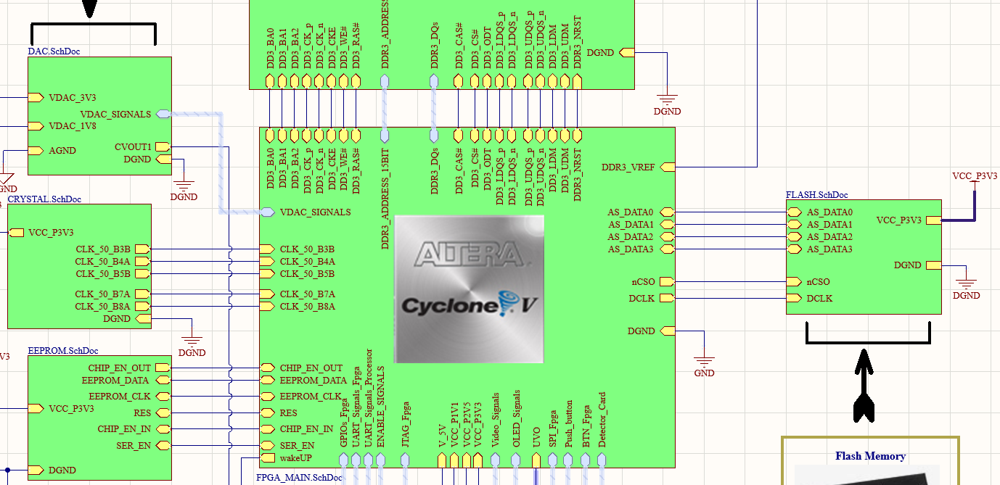
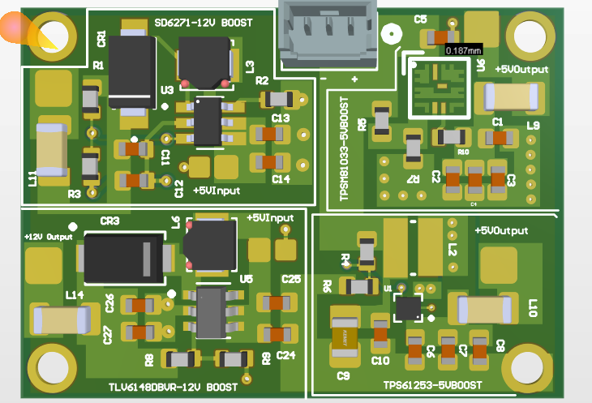
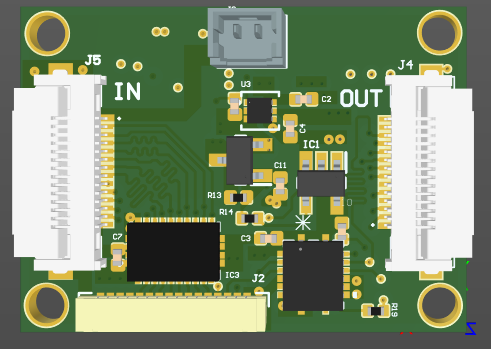

# Jaweria Alam | PCB Design Engineer

Hardware engineer with **2 years of hands-on PCB design experience**, focused on multi-layer boards for FPGA and processor-based systems. I take designs from schematic capture through layout, fabrication and board bring-up.

---

## What I Do

- Multi-layer PCB design for **FPGA and processor boards**
- **Power card design**: multi-rail supplies for FPGAs and processors
- **Display interface cards**: OLED display boards
- Schematic capture, stackup planning, placement, routing and DRC
- Fabrication outputs: Gerbers, drill files, BOM, assembly drawings
- Hardware bring-up and debugging

## Tools

| Area | Tools |
|------|-------|
| PCB CAD | Altium Designer, [Eagle / KiCad / others] |
| Programmable logic | Vivado, [others] |
| Lab equipment | Oscilloscope, multimeter, [others] |

---

## Featured Projects

### 1. FPGA + Processor Multi-Layer Board

- **Summary:** [One line: what the board does]
- **Layers:** [e.g. 8-layer stackup]
- **Key features:** [FPGA family, memory, interfaces, connectors]
- **My role:** Schematic design, layout, [bring-up]
- [Repo link]

### 2. Power Card for FPGA / Processor

- **Summary:** [Input voltage → output rails and currents]
- **Key features:** [Regulator types, sequencing, protection]
- **Results:** [Ripple or load test measurements]
- [Repo link]

### 3. OLED Display Card

- **Summary:** Display interface board for an OLED panel
- **Interface:** [I2C / SPI / parallel]
- **Results:** [Photo of the working display]
- [Repo link]

---

## Skills

- Multi-layer stackup design and layer assignment
- Component selection and custom footprint creation
- Power integrity basics: decoupling, power plane design
- Signal routing: [differential pairs / length matching / controlled impedance, only what you have done]
- Design for manufacturing: Gerber, drill and BOM generation
- Soldering, rework and board bring-up (SMT and through-hole)
- Debugging with scope and multimeter

## Experience

**PCB Design Engineer** | LEOS / NUST] | [2024-Present]

---

## Contact

- Email: [jaweriaalam490@gmail.com]

