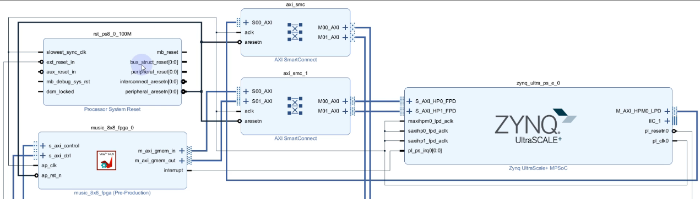
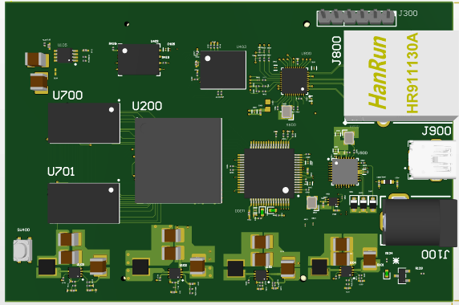

# Jaweria Alam | PCB Design & FPGA Engineer

Hardware engineer with **2 years of hands-on PCB design experience**, focused on multi-layer boards for FPGA and processor-based systems. I also develop **FPGA firmware and DSP implementations**, and take designs from schematic capture through layout, fabrication and board bring-up.

---

## What I Do

- Multi-sheet schematic design for **FPGA and processor systems**
- Multi-layer PCB design for **FPGA and processor boards**
- **Power card design** with buck and boost converters
- **Display interface cards**: OLED driver boards
- **FPGA firmware development** and DSP implementation on Zynq
- Embedded Linux fundamentals
- Schematic capture, stackup planning, placement, routing and DRC
- Fabrication outputs: Gerbers, drill files, BOM, assembly drawings
- Hardware bring-up and debugging

## Tools

| Area | Tools |
|------|-------|
| PCB CAD | Altium Designer, [Eagle / KiCad / others] |
| Programmable logic | Vivado, [Verilog / VHDL / HLS] |
| Embedded | Embedded Linux basics, [PetaLinux / others] |
| Lab equipment | Oscilloscope, multimeter, [others] |

---

## Featured Projects

### 1. FPGA Implementation of MUSIC Algorithm for DOA (Zynq UltraScale+)

- **Summary:** FPGA implementation of the MUSIC (Multiple Signal Classification) algorithm for direction-of-arrival estimation
- **Platform:** Zynq UltraScale+
- **Implementation:** [Covariance matrix, eigen-decomposition, spectrum search: what you built in hardware vs. software]

### 2. Zynq-7000 Board (XC7Z010-2CLG400I)

- **Summary:** Complete schematic and PCB design of a board built around the XC7Z010-2CLG400I
- **Layers:** [e.g. 6-layer stackup]
- **Key features:** [DDR memory, interfaces, connectors, power rails]
- **My role:** Schematic design, layout, [bring-up]

### 3. FPGA + Processor Multi-Sheet Board

- **Summary:** Hierarchical multi-sheet schematic and multi-layer PCB for an FPGA and processor system
- **Layers:** [e.g. 8-layer stackup]
- **Key features:** [FPGA family, memory, interfaces, connectors]
- **My role:** Schematic design, layout, [bring-up]

### 4. Power Card

- **Summary:** Power card with buck and boost converters, pushbutton, ADC, WiFi and Ethernet
- **Specs:** [Input voltage → output rails and currents]
- **Results:** [Ripple or load test measurements]

### 5. OLED Driver Board

- **Summary:** Schematic and PCB design of a driver board for an OLED panel
- **Interface:** [I2C / SPI / parallel]
- **Results:** [Photo of the working display]

---

## Skills

- Multi-layer stackup design and layer assignment
- Component selection and custom footprint creation
- Power supply design: buck, boost, decoupling, power planes
- FPGA firmware development ([Verilog / VHDL], Vivado)
- DSP on FPGA (MUSIC / DOA)
- Embedded Linux basics
- Signal routing: [differential pairs / length matching / controlled impedance, only what you have done]
- Design for manufacturing: Gerber, drill and BOM generation
- Soldering, rework and board bring-up (SMT and through-hole)
- Debugging with scope and multimeter

## Experience

**PCB Design Engineer** | LEOS / NUST | 2024 to Present
- Designed schematics and multi-layer PCBs for FPGA and processor-based boards
- Developed an FPGA implementation of the MUSIC algorithm for DOA estimation on Zynq UltraScale+

---

## Contact

- Email: jaweriaalam490@gmail.com
